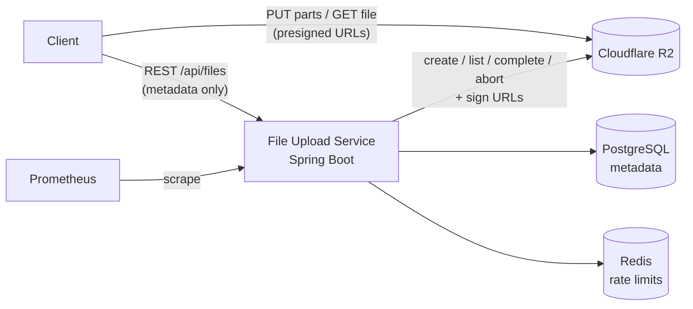

# File Upload Service

A Spring Boot backend for **uploading and downloading large files** with **Cloudflare R2** (S3-compatible) as storage and **PostgreSQL** for metadata.

File bytes **never pass through the server**. The service handles metadata, ownership and authorization, and issues short-lived **presigned URLs**; clients upload parts and download files **directly from R2**. Memory and bandwidth use on the app server stays the same regardless of file size, and the service scales horizontally.


---

## Features

- **Multipart uploads via presigned URLs**: 5 MB+ parts PUT straight to R2; parallelizable and resumable
- **Presigned downloads** (15-minute expiry)
- **Server-side verification on completion**: the authoritative part list comes from R2 (`ListParts`), not the client; S3 part rules are enforced (≤10,000 parts, ≥5 MB except the last)
- **Per-user isolation**: ownership check on every operation (returns 404, not 403, so file IDs can't be probed); R2 keys stored under per-user prefixes `{userId}/{fileId}/{name}`
- **Idempotent upload initiation** with the `Idempotency-Key` header
- **Distributed rate limiting**: token buckets in Redis (Bucket4j), per user and per action, consistent across instances
- **Self-healing reconciliation**: a scheduled job aborts uploads abandoned for more than 24h, so orphaned parts aren't billed; uses `FOR UPDATE SKIP LOCKED`, so it's safe to run on many instances at once
- **Observability**: `X-Request-Id` correlation, structured **JSON logs**, **Prometheus** metrics (`uploads_initiated_total`, `uploads_completed_total`, `uploads_failed_total`, completion latency)
- **Uniform error contract**: `{ code, message, requestId }` with stable error codes
- **Versioned schema** with Flyway; Hibernate only validates the schema
- **Containerized**: multi-stage Dockerfile + docker-compose (app, Postgres, Redis)
- **Browser test client** at `/` with chunked upload, a progress bar and download

## Architecture



**Upload flow:** `POST /api/files` → for each part: `GET .../parts/{n}/presign`, then `PUT` to R2 → `POST .../complete`

Full details (layers, data model, state machine, sequence diagrams, design trade-offs): **[docs/DOCUMENTATION.md](docs/DOCUMENTATION.md)**

## Tech Stack

Java 17 · Spring Boot 3.2 (Web, Data JPA, Validation, Actuator) · PostgreSQL 16 · Flyway · AWS SDK v2 (S3) · Cloudflare R2 · Redis 7 · Bucket4j · Micrometer/Prometheus · Logback + Logstash encoder · Gradle · Docker

## Getting Started

### Prerequisites

- Docker + Docker Compose (JDK 17+ only if running outside Docker)
- A Cloudflare R2 bucket and an R2 API token with Object Read & Write
- A **CORS policy on the bucket**, required because browsers upload directly to R2 and must read the `ETag` header:

```json
[{
  "AllowedOrigins": ["http://localhost:8080"],
  "AllowedMethods": ["GET", "PUT"],
  "AllowedHeaders": ["*"],
  "ExposeHeaders": ["ETag"],
  "MaxAgeSeconds": 3600
}]
```

### Run with Docker Compose

```bash
git clone <repo-url> && cd file-upload-service

# R2 credentials. .env is read by docker compose; never commit it.
cat > .env <<'EOF'
R2_ACCOUNT_ID=your-account-id
R2_ACCESS_KEY=your-access-key
R2_SECRET_KEY=your-secret-key
R2_BUCKET_NAME=your-bucket
EOF

docker compose up --build
```

Open **http://localhost:8080** to use the upload UI.

### Run locally (dependencies in Docker)

```bash
docker compose up -d postgres redis

export R2_ACCOUNT_ID=... R2_ACCESS_KEY=... R2_SECRET_KEY=... R2_BUCKET_NAME=...
# PowerShell: $env:R2_ACCOUNT_ID="..."; $env:R2_ACCESS_KEY="..."; ...

./gradlew clean bootRun
```

### Configuration

| Variable | Default | Description |
|---|---|---|
| `R2_ACCOUNT_ID` | — (required) | Cloudflare account ID |
| `R2_ACCESS_KEY` / `R2_SECRET_KEY` | — (required) | R2 API token credentials |
| `R2_BUCKET_NAME` | — (required) | Bucket name |
| `R2_ENDPOINT` | derived from account ID | Override for MinIO/other S3-compatible storage |
| `DB_HOST` / `DB_PORT` / `DB_NAME` | `localhost` / `5432` / `file_upload_db` | PostgreSQL |
| `DB_USERNAME` / `DB_PASSWORD` | `postgres` / `password123` | Dev defaults only; override in any real environment |
| `REDIS_HOST` / `REDIS_PORT` | `localhost` / `6379` | Redis |

Database migrations run automatically on startup.

## API

All `/api/*` endpoints require an `X-User-Id` header.

| Method | Endpoint | Description |
|---|---|---|
| `POST` | `/api/files` | Start an upload (optional `Idempotency-Key`) → `201` |
| `GET` | `/api/files/{id}/parts/{partNumber}/presign` | Presigned PUT URL for a part |
| `GET` | `/api/files/{id}/parts` | Parts already in R2 (for resume) |
| `POST` | `/api/files/{id}/complete` | Complete the upload |
| `POST` | `/api/files/{id}/abort` | Abort the upload → `204` |
| `GET` | `/api/files/{id}/download` | Presigned download URL |
| `GET` | `/api/files?page=0&size=20` | List my files (paginated) |
| `DELETE` | `/api/files/{id}` | Delete (soft delete in DB; object removed from R2) → `204` |
| `GET` | `/actuator/health`, `/actuator/prometheus` | Health and metrics |

**Example**

```bash
curl -X POST http://localhost:8080/api/files \
  -H "X-User-Id: demo-user" \
  -H "Idempotency-Key: 7f9c-001" \
  -H "Content-Type: application/json" \
  -d '{"fileName":"video.mp4","mimeType":"video/mp4","totalSizeBytes":52428800}'
```
```json
{ "id": "4daeb92e-...", "fileName": "video.mp4", "mimeType": "video/mp4",
  "totalSizeBytes": 52428800, "status": "UPLOADING", "createdAt": "2026-08-23T19:45:25+05:30" }
```

**Errors**: always `{ "code": "...", "message": "...", "requestId": "..." }`

| Status | Code |
|---|---|
| 400 | `VALIDATION_ERROR` |
| 404 | `FILE_NOT_FOUND` |
| 409 | `INVALID_UPLOAD_STATE` |
| 429 | `RATE_LIMIT_EXCEEDED` |
| 502 | `UPSTREAM_STORAGE_ERROR` |
| 500 | `INTERNAL_ERROR` |

**Rate limits** (per user): 10 upload initiations/min · 100 part presigns/min.

## Upload Lifecycle

```
INITIATED ──► UPLOADING ──► COMPLETED
                  │
                  ├──► FAILED            (user abort)
                  └──► RECONCILING ──► FAILED   (abandoned > 24h, cleaned up by scheduler)
```

## Project Structure

```
src/main/java/org/application/
├── controller/      FileController (REST)
├── s3service/       FileService, S3StorageService, RateLimitService, ReconciliationService, R2KeyGenerator
├── security/        RequestIdFilter, UserContextFilter, UserContext
├── config/          FilterConfig, RateLimiterConfig, R2Properties
├── entity/          Files, FileChunk, UploadStatus
├── repository/      Spring Data JPA repositories
├── dto/             Request/response records
├── exception/       Domain exceptions
└── GlobalExceptionHandler.java
src/main/resources/
├── application.yml, logback-spring.xml
├── db/migration/    Flyway V1–V4
└── static/index.html  Browser test client
```

## Testing

- **Manual and functional checks**: see the [Manual Testing Guide](docs/DOCUMENTATION.md#12-manual-testing-guide)
- **Rate limiting under concurrency**: `./test-rate-limit-concurrent.ps1` (user 1: 10×`201` then `429`; user 2 unaffected)
- Automated tests (JUnit 5, Testcontainers, MinIO) are on the roadmap

## Roadmap

- [ ] Unit and integration tests (Testcontainers + MinIO)
- [ ] JWT authentication with Spring Security (replacing the `X-User-Id` placeholder)
- [ ] Parallel and resumable uploads in the client
- [ ] Checksum verification
- [ ] GitHub Actions CI, Grafana dashboard, OpenAPI docs

Known limitations are listed in [docs/DOCUMENTATION.md §14](docs/DOCUMENTATION.md#14-known-limitations-and-open-issues).

> ⚠️ **Note:** identity currently comes from the `X-User-Id` header without verification. This is a placeholder for real authentication; don't deploy publicly as-is.
