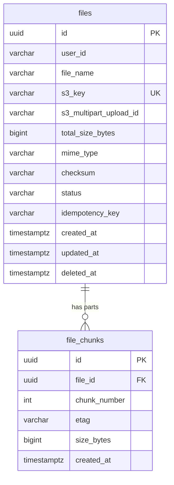
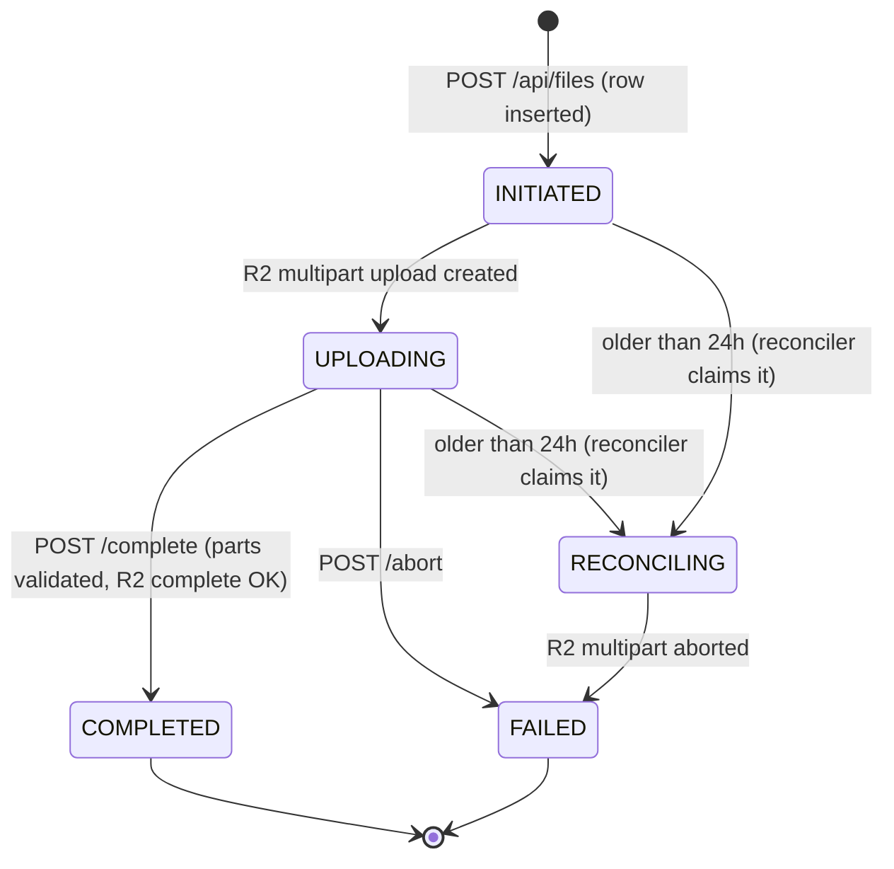
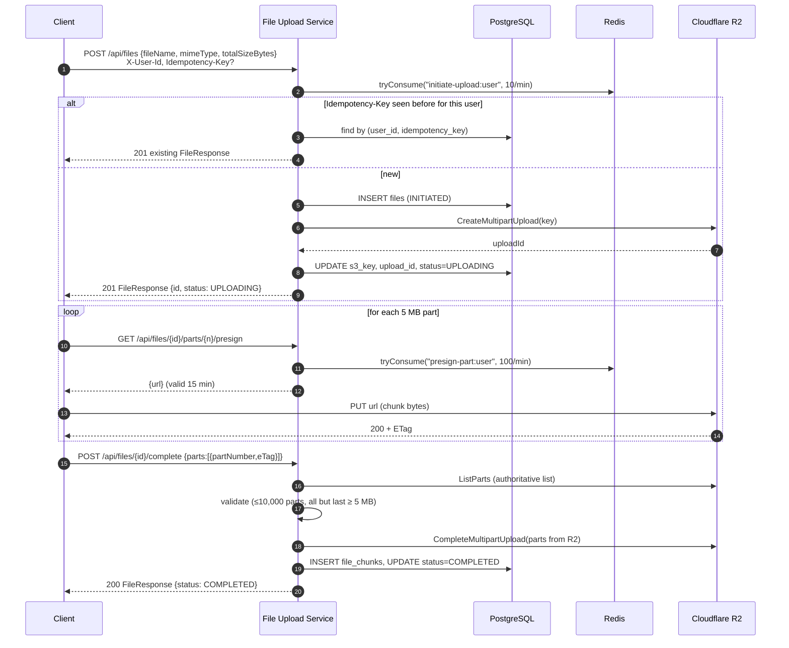
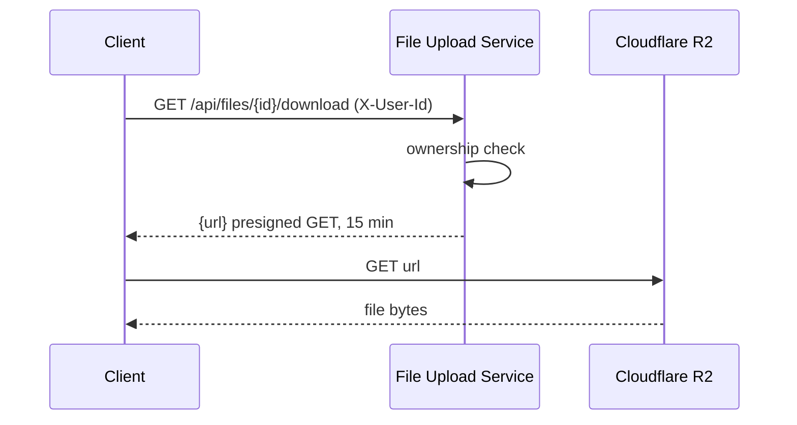

# File Upload Service — Technical Documentation

This document describes how the service is built: its architecture, its features and the reasoning behind them, its data model and API, how to build, run and test it, and its known limitations.

> The quick-start lives in the [README](../README.md). This document covers the details.

---

## Table of Contents

1. [Overview](#1-overview)
2. [Tech Stack](#2-tech-stack)
3. [Architecture](#3-architecture)
4. [Project Structure](#4-project-structure)
5. [Data Model](#5-data-model)
6. [Upload Lifecycle (State Machine)](#6-upload-lifecycle-state-machine)
7. [Request Flows](#7-request-flows)
8. [API Reference](#8-api-reference)
9. [Features in Depth](#9-features-in-depth)
10. [Configuration](#10-configuration)
11. [Build and Run](#11-build-and-run)
12. [Manual Testing Guide](#12-manual-testing-guide)
13. [Design Decisions and Trade-offs](#13-design-decisions-and-trade-offs)
14. [Known Limitations and Open Issues](#14-known-limitations-and-open-issues)
15. [Roadmap](#15-roadmap)
16. [Development History](#16-development-history)

---

## 1. Overview

**File Upload Service** is a Spring Boot backend for uploading and downloading large files, using **Cloudflare R2**, which is S3-compatible, as blob storage and **PostgreSQL** for file metadata.

Its main design choice: **file bytes never pass through the application server.** The service only manages metadata and *authorization*. It hands the client short-lived **presigned URLs**, and the client uploads parts directly to R2 and downloads directly from R2. As a result, the app's CPU, memory and bandwidth use stays the same regardless of file size, so the service can scale horizontally.

Core capabilities:

- **Multipart uploads** with presigned URLs, one per part, for parallel and resumable uploads of large files
- **Presigned downloads**
- **Per-user ownership and isolation**: each user can only see their own files, and objects are stored under per-user R2 key prefixes
- **Idempotent upload initiation** through an `Idempotency-Key` header
- **Distributed, per-user rate limiting** with Bucket4j on Redis
- **Background reconciliation** that cleans up abandoned uploads, so R2 doesn't keep charging for orphaned parts
- **Observability**: request-ID correlation, structured JSON logs and Prometheus metrics
- **Consistent JSON error contract** with machine-readable error codes
- **Containerized** with Docker and docker-compose

---

## 2. Tech Stack

| Concern | Technology |
|---|---|
| Language / Runtime | Java 17 |
| Framework | Spring Boot 3.2.4 (Spring MVC, servlet stack) |
| Persistence | Spring Data JPA / Hibernate, PostgreSQL 16 |
| Schema migrations | Flyway (`ddl-auto: validate`; Hibernate only validates the schema) |
| Object storage | Cloudflare R2 via AWS SDK for Java v2 (`s3` 2.25.0) |
| Rate limiting | Bucket4j 8.10.1 + Redis 7 (Lettuce client) |
| Validation | Jakarta Bean Validation (`spring-boot-starter-validation`) |
| Logging | Logback + `logstash-logback-encoder` (JSON) + SLF4J MDC |
| Metrics | Spring Boot Actuator + Micrometer + Prometheus registry |
| Build | Gradle 8.14 (wrapper) |
| Packaging | Multi-stage Dockerfile, docker-compose |
| Test client | Static HTML/JS page (`src/main/resources/static/index.html`) |
| Boilerplate | Lombok (entities) |

---

## 3. Architecture

### 3.1 High-level view

```mermaid
flowchart LR
    subgraph Client
        B[Browser / API client]
    end

    subgraph App["File Upload Service (Spring Boot)"]
        F1[RequestIdFilter<br/>order 0]
        F2[UserContextFilter<br/>order 1]
        C[FileController]
        RL[RateLimitService]
        FS[FileService]
        S3S[S3StorageService]
        REC[ReconciliationService<br/>@Scheduled every 15 min]
        EH[GlobalExceptionHandler]
        ACT[Actuator<br/>/actuator/health<br/>/actuator/prometheus]
    end

    PG[(PostgreSQL<br/>metadata)]
    RD[(Redis<br/>rate-limit buckets)]
    R2[(Cloudflare R2<br/>file bytes)]
    PROM[Prometheus]

    B -- "REST /api/files (metadata only)" --> F1 --> F2 --> C
    C --> RL --> RD
    C --> FS
    FS --> PG
    FS --> S3S
    REC --> PG
    REC --> S3S
    S3S -- "S3 API: create/list/complete/abort,<br/>sign URLs" --> R2
    B -- "PUT part / GET object<br/>(presigned URL, direct)" --> R2
    PROM -- scrape --> ACT
```

**Key point:** there are two separate data paths.

1. **Control plane** (client → app): small JSON requests to start, sign, complete, list and delete.
2. **Data plane** (client → R2): the file bytes, sent directly to R2 using URLs the app signed.

### 3.2 Layers

| Layer | Classes | Responsibility |
|---|---|---|
| **Filters** | `RequestIdFilter`, `UserContextFilter`, `FilterConfig` | Assign a request ID and put it in the MDC; resolve and enforce caller identity |
| **Controller** | `FileController` | HTTP mapping, input validation (`@Valid`), rate-limit checks |
| **Service** | `FileService` | Upload/download business logic, ownership checks, state transitions, metrics |
| **Storage adapter** | `S3StorageService`, `R2KeyGenerator` | All R2/S3 SDK calls and presigning; object key generation |
| **Background jobs** | `ReconciliationService` | Finds and cleans up stale uploads |
| **Cross-cutting** | `RateLimitService`, `RateLimiterConfig`, `GlobalExceptionHandler` | Distributed rate limiting; error translation |
| **Persistence** | `FileRepository`, `FileChunkRepository`, `Files`, `FileChunk`, `UploadStatus` | JPA entities and queries |
| **Config** | `R2Properties`, `application.yml`, `logback-spring.xml` | Externalized configuration |

### 3.3 Request pipeline (for `/api/*`)

```
HTTP request
  └─ RequestIdFilter (order 0)   → generates a UUID, puts it in MDC["requestId"], sets the X-Request-Id response header
      └─ UserContextFilter (order 1) → reads X-User-Id; 401 if missing; stores it in the request-scoped UserContext
          └─ DispatcherServlet → FileController
                 ├─ RateLimitService.tryConsume(...)  (initiate + presign only)
                 └─ FileService → FileRepository / S3StorageService
  (any exception) → GlobalExceptionHandler → ErrorResponse {code, message, requestId}
```

Both filters are registered **only for `/api/*`**, so static assets (`/index.html`) and actuator endpoints are not affected.

---

## 4. Project Structure

```
file-upload-service/
├── build.gradle, settings.gradle, gradlew*      # Gradle build
├── Dockerfile                                   # Multi-stage build (Gradle → JRE 17 Alpine)
├── docker-compose.yml                           # postgres + redis + app
├── test-rate-limit-concurrent.ps1               # Concurrent rate-limit test script
├── docs/DOCUMENTATION.md                        # This file
└── src/main/
    ├── java/org/application/
    │   ├── Main.java                            # Entry point; @EnableScheduling, @EnableConfigurationProperties
    │   ├── GlobalExceptionHandler.java          # Exception → ErrorResponse mapping
    │   ├── config/
    │   │   ├── FilterConfig.java                # Registers filters on /api/* with explicit order
    │   │   ├── R2Properties.java                # @ConfigurationProperties("r2") record
    │   │   └── RateLimiterConfig.java           # Lettuce RedisClient + Bucket4j ProxyManager
    │   ├── controller/FileController.java       # REST endpoints under /api/files
    │   ├── dto/                                 # Request/response records
    │   ├── entity/                              # Files, FileChunk, UploadStatus
    │   ├── exception/                           # Domain exceptions
    │   ├── repository/                          # Spring Data JPA repositories
    │   ├── s3service/
    │   │   ├── FileService.java                 # Core business logic
    │   │   ├── S3StorageService.java            # R2/S3 SDK adapter
    │   │   ├── R2KeyGenerator.java              # Object key builder + filename sanitization
    │   │   ├── RateLimitService.java            # Token-bucket checks
    │   │   └── ReconciliationService.java       # Scheduled stale-upload cleanup
    │   └── security/
    │       ├── RequestIdFilter.java
    │       ├── UserContext.java                 # @RequestScope holder for the caller's userId
    │       └── UserContextFilter.java
    └── resources/
        ├── application.yml
        ├── logback-spring.xml                   # JSON console logging incl. requestId
        ├── db/migration/V1..V4__*.sql           # Flyway migrations
        └── static/index.html                    # Browser test client
```

---

## 5. Data Model

### 5.1 ER diagram



### 5.2 `files`

| Column | Type | Notes |
|---|---|---|
| `id` | `uuid` PK | Generated by Hibernate (`GenerationType.UUID`); DB default `gen_random_uuid()` |
| `user_id` | `varchar(255)` NOT NULL | Owner (from `X-User-Id`) |
| `file_name` | `varchar(255)` NOT NULL | Original file name, as submitted |
| `s3_key` | `varchar(1024)` UNIQUE | Object key in R2: `{userId}/{fileId}/{sanitizedName}` |
| `s3_multipart_upload_id` | `varchar(1024)` | R2 multipart upload ID (widened in V2; R2 IDs are long) |
| `total_size_bytes` | `bigint` NOT NULL, `> 0` | Declared size |
| `mime_type` | `varchar(100)` NOT NULL | |
| `checksum` | `varchar(64)` | Reserved; not populated yet |
| `status` | `varchar(20)` NOT NULL | CHECK constraint; see the state machine |
| `idempotency_key` | `varchar(255)` | Added in V3; `UNIQUE (user_id, idempotency_key)` |
| `created_at` / `updated_at` | `timestamptz` | Maintained by `@PrePersist` / `@PreUpdate` |
| `deleted_at` | `timestamptz` | Soft delete marker |

**Indexes**
- `idx_files_user_id_created_at (user_id, created_at DESC)`: supports "list my files, newest first" without a full table scan.
- `uq_files_user_idempotency_key (user_id, idempotency_key)`: an idempotency key is unique *per user*. Postgres allows multiple NULLs, so requests without a key are unaffected.

### 5.3 `file_chunks`

Stores the **final, verified** part list of a completed upload: part number, ETag and size, as reported by R2.

- `UNIQUE (file_id, chunk_number)`, `chunk_number > 0`, `size_bytes > 0`
- `FOREIGN KEY (file_id) REFERENCES files(id) ON DELETE CASCADE`

### 5.4 Migrations

| Version | Purpose |
|---|---|
| `V1__init.sql` | `pgcrypto` extension; `files`, `file_chunks`, indexes, constraints |
| `V2__widen_multipart_upload_id.sql` | `s3_multipart_upload_id` → `varchar(1024)` (R2 upload IDs exceeded 255 chars) |
| `V3__add_idempotency_key.sql` | `idempotency_key` column and per-user unique constraint |
| `V4__add_reconciling_status.sql` | Adds `RECONCILING` to the status CHECK constraint |

> Status is stored as `varchar` + CHECK constraint, not as a Postgres `ENUM`. It maps cleanly to `@Enumerated(EnumType.STRING)`, and adding a value is a simple constraint swap (as V4 shows) instead of an `ALTER TYPE`.

---

## 6. Upload Lifecycle (State Machine)



| Status | Meaning |
|---|---|
| `INITIATED` | Row exists, R2 multipart upload not yet created. This state lasts only a moment, unless the R2 call failed. |
| `UPLOADING` | R2 multipart upload exists; client is uploading parts |
| `PROCESSING` | Reserved for future post-processing (virus scan, thumbnails); currently unused |
| `RECONCILING` | Claimed by the reconciliation job; being cleaned up |
| `COMPLETED` | Object assembled in R2 and downloadable |
| `FAILED` | Aborted by the user or cleaned up by reconciliation |

Soft delete (`deleted_at`) is independent of `status`.

---

## 7. Request Flows

### 7.1 Multipart upload



**Why `/complete` uses R2's part list instead of the client's:** the client's part list can't be trusted, since it could be buggy, stale or tampered with. The service calls `ListParts` and uses **R2's own record** of what was uploaded. The request body must be non-empty (`@NotEmpty`), but the server decides which parts are used.

### 7.2 Download



### 7.3 Resume an interrupted upload

`GET /api/files/{id}/parts` returns the parts R2 already has. A client can compare that list with its local chunks and upload only the missing ones before calling `/complete`. The bundled `index.html` does **not** implement resume yet (see [§14](#14-known-limitations-and-open-issues)).

---

## 8. API Reference

Base path: `/api/files`. **All endpoints require the `X-User-Id` header.**

| Method | Path | Description | Success |
|---|---|---|---|
| `POST` | `/api/files` | Start a multipart upload | `201` `FileResponse` |
| `GET` | `/api/files/{fileId}/parts/{partNumber}/presign` | Presigned PUT URL for one part | `200` `{ "url": "..." }` |
| `GET` | `/api/files/{fileId}/parts` | Parts already uploaded (from R2) | `200` `PartSummary[]` |
| `POST` | `/api/files/{fileId}/complete` | Finish the upload | `200` `FileResponse` |
| `POST` | `/api/files/{fileId}/abort` | Abort the upload | `204` |
| `GET` | `/api/files/{fileId}/download` | Presigned GET URL | `200` `{ "url": "..." }` |
| `GET` | `/api/files?page=0&size=20&sort=createdAt,desc` | List caller's files (paginated, excludes soft-deleted) | `200` `Page<FileResponse>` |
| `DELETE` | `/api/files/{fileId}` | Soft delete + delete R2 object | `204` |

Operational endpoints (no `X-User-Id` needed): `GET /actuator/health`, `GET /actuator/prometheus`.

### 8.1 Headers

| Header | Direction | Purpose |
|---|---|---|
| `X-User-Id` | request, **required** | Caller identity (see [§9.1](#91-caller-identity-x-user-id)) |
| `Idempotency-Key` | request, optional | Deduplicates `POST /api/files` |
| `X-Request-Id` | response | Correlation ID; also in logs and error bodies |

### 8.2 Payloads

**InitiateUploadRequest**
```json
{ "fileName": "video.mp4", "mimeType": "video/mp4", "totalSizeBytes": 52428800 }
```
Validation: `fileName` not blank, ≤255 chars; `mimeType` not blank, ≤100 chars; `totalSizeBytes` > 0.

**FileResponse**
```json
{
  "id": "4daeb92e-de75-4c4e-ab0a-57abc9b8c080",
  "fileName": "video.mp4",
  "mimeType": "video/mp4",
  "totalSizeBytes": 52428800,
  "status": "UPLOADING",
  "createdAt": "2026-08-23T19:45:25.311+05:30"
}
```

**CompleteUploadRequest**
```json
{ "parts": [ { "partNumber": 1, "eTag": "\"a1b2...\"" }, { "partNumber": 2, "eTag": "\"c3d4...\"" } ] }
```

**PartSummary**
```json
{ "partNumber": 1, "eTag": "\"a1b2...\"", "sizeBytes": 5242880 }
```

### 8.3 Error contract

Every handled error returns:
```json
{ "code": "FILE_NOT_FOUND", "message": "File not Found : f90246f0-...", "requestId": "3a83dc95-..." }
```

| HTTP | `code` | When |
|---|---|---|
| 400 | `VALIDATION_ERROR` | Bean validation failed (messages joined with `; `) |
| 401 | *(servlet error page, not JSON)* | Missing `X-User-Id` |
| 404 | `FILE_NOT_FOUND` | File doesn't exist **or belongs to another user** |
| 404 | `RESOURCE_NOT_FOUND` | Unknown static resource |
| 409 | `INVALID_UPLOAD_STATE` | `/complete` when not `UPLOADING`, no parts, parts < 5 MB, > 10,000 parts |
| 429 | `RATE_LIMIT_EXCEEDED` | Token bucket empty |
| 502 | `UPSTREAM_STORAGE_ERROR` | Any AWS SDK / R2 error (`SdkException`) |
| 500 | `INTERNAL_ERROR` | Anything else (details only in logs, never leaked) |

---

## 9. Features in Depth

### 9.1 Caller identity (`X-User-Id`)

`UserContextFilter` reads `X-User-Id` and stores it in `UserContext`, a `@RequestScope` bean, so controllers and services don't depend on HTTP details. A missing or blank header is rejected with **401** before reaching any controller.

> ⚠️ This is **trust-based identity**, a placeholder for real authentication. Anyone can send any user ID. The design keeps the change small: replacing the filter with a JWT/Spring Security filter that fills the same `UserContext` changes nothing downstream.

### 9.2 Ownership and isolation

- Every per-file operation goes through `FileService.getOwnedFileOrThrow(userId, fileId)`.
- If the file belongs to someone else, the service returns **404, not 403**. That way a caller can't probe which file IDs exist.
- R2 keys are prefixed by user: `{userId}/{fileId}/{sanitizedFileName}` (`R2KeyGenerator`). This gives a clean per-user layout in the bucket, makes per-user cleanup easy, and the `fileId` segment guarantees uniqueness even for identical file names.
- File names are sanitized (`[^A-Za-z0-9._-]` → `_`, keeping the last 255 chars) to avoid path tricks and odd characters in keys.

### 9.3 Presigned URLs

- Part upload URLs and download URLs are signed with **15-minute** expiry (`S3StorageService`).
- The browser uploads each chunk with a plain `PUT` to the URL and reads back the `ETag` response header.
- Two SDK clients are used: `S3Client` for control operations and `S3Presigner` for signing. Both target R2 with region `auto`. `chunkedEncodingEnabled(false)` is set because R2 doesn't support AWS chunked payload signing.
- The endpoint is configurable (`R2_ENDPOINT`), so the same code can point at MinIO/LocalStack for local development (`R2_PATH_STYLE_ACCESS` is available for that).

### 9.4 Multipart validation

On `/complete`, `FileService.validateParts` enforces the S3 multipart rules before calling R2:
- At most **10,000** parts.
- Every part **except the last** must be at least **5 MB** (`MIN_PART_SIZE`).

R2 would reject these anyway. Checking first produces a clear `409 INVALID_UPLOAD_STATE` instead of an opaque upstream error.

### 9.5 Idempotent initiation

Clients can send `Idempotency-Key` with `POST /api/files`. If `(userId, key)` already exists, the **original** `FileResponse` is returned and no new row or R2 multipart upload is created. This covers the common case of a client retrying after a network timeout, which would otherwise leave duplicate orphaned uploads. The DB unique constraint is the final safeguard.

### 9.6 Distributed rate limiting

- **Algorithm:** token bucket (Bucket4j), with **greedy refill** (tokens trickle back continuously instead of all at once at a window boundary).
- **Storage:** Redis, through `LettuceBasedProxyManager`. Bucket state is shared, so the limits hold **across multiple app instances**. An in-memory limiter would give each instance its own allowance.
- **Key:** `"{action}:{userId}"`. Limits are **per user and per action**, so one user's heavy traffic doesn't affect another user (verified by `test-rate-limit-concurrent.ps1`).
- **Expiry:** buckets expire in Redis after they would have fully refilled (`basedOnTimeForRefillingBucketUpToMax(10 min)`), so idle users don't leave keys behind.

| Action | Limit |
|---|---|
| `initiate-upload` | 10 requests / minute / user |
| `presign-part` | 100 requests / minute / user |

When a bucket is empty the service returns **429 `RATE_LIMIT_EXCEEDED`**.

### 9.7 Reconciliation of abandoned uploads

**Problem:** if a client starts a multipart upload and never completes or aborts it (tab closed, crash), R2 keeps the uploaded parts **and bills for them**, while the DB row stays `UPLOADING` forever.

**Solution:** `ReconciliationService.reconcileStaleUploads()` runs every **15 minutes** (`@Scheduled(fixedDelay = 15, MINUTES)`):

1. **Claim** a batch of up to 50 rows that are `INITIATED`/`UPLOADING` and older than **24h**, in a single atomic statement:
   ```sql
   UPDATE files SET status='RECONCILING', updated_at=now()
   WHERE id IN (SELECT id FROM files
                WHERE status IN ('UPLOADING','INITIATED') AND created_at < :cutoff
                LIMIT :batchSize FOR UPDATE SKIP LOCKED)
   RETURNING id
   ```
   `FOR UPDATE SKIP LOCKED` lets **multiple app instances run the job at the same time** without processing the same row twice and without blocking each other.
2. For each claimed row: abort the R2 multipart upload if one exists, which frees the stored parts, then mark the row `FAILED` and increment `uploads.failed`.
3. Failures are logged per row and don't stop the rest of the batch.

### 9.8 Error handling

`GlobalExceptionHandler` (`@RestControllerAdvice`) maps exceptions to a single `ErrorResponse { code, message, requestId }` shape (table in [§8.3](#83-error-contract)). Benefits:
- Clients branch on a stable `code`, not on message text.
- Every error carries the `requestId`, so a user-reported error can be matched to its log line immediately.
- Unexpected exceptions are logged with their stack trace server-side, while the client only gets a generic message, so internals don't leak.
- Storage failures are reported as **502**, which makes clear the problem is upstream (R2), not in the service.

### 9.9 Observability

**Request correlation:** `RequestIdFilter` generates a UUID per request, puts it in the SLF4J **MDC** and returns it in `X-Request-Id`. The MDC entry is removed in `finally` because servlet threads are pooled and reused.

**Structured logging:** `logback-spring.xml` uses `LogstashEncoder`, so every log line is a JSON object including `requestId`:
```json
{"@timestamp":"2026-08-23T19:45:25.311+05:30","message":"Started Main in 24.359 seconds","logger_name":"org.application.Main","thread_name":"main","level":"INFO","requestId":"..."}
```
JSON logs can be ingested by ELK, Loki, Datadog and similar tools without regex parsing.

**Metrics** (Micrometer → `/actuator/prometheus`):

| Micrometer name | Prometheus series | Type | Incremented when |
|---|---|---|---|
| `uploads.initiated` | `uploads_initiated_total` | Counter | Upload successfully initiated |
| `uploads.completed` | `uploads_completed_total` | Counter | Upload completed |
| `uploads.failed` | `uploads_failed_total` | Counter | User abort or reconciliation |
| `uploads.completion.duration` | `uploads_completion_duration_seconds_{count,sum,max}` | Timer | Duration of `/complete` (wraps R2 ListParts + Complete) |

Plus the standard JVM, HTTP-server (`http_server_requests_seconds`), HikariCP and other auto-configured metrics. Example PromQL:
```promql
rate(uploads_failed_total[5m]) / rate(uploads_initiated_total[5m])      # failure ratio
rate(uploads_completion_duration_seconds_sum[5m]) / rate(uploads_completion_duration_seconds_count[5m])  # avg completion latency
```

### 9.10 Soft delete

`DELETE /api/files/{id}` sets `deleted_at` (the row is kept for audit and history), then deletes the object from R2. Listing excludes soft-deleted rows.

### 9.11 Browser test client

`src/main/resources/static/index.html`, served at `http://localhost:8080/`: enter a user ID, choose a file, and it splits the file into 5 MB chunks, presigns and PUTs each one sequentially with a progress bar, completes the upload, then offers a "Download Last Uploaded File" button.

---

## 10. Configuration

All configuration is in `src/main/resources/application.yml` and comes from **environment variables**. No secrets are committed.

| Variable | Default | Required | Description |
|---|---|---|---|
| `R2_ACCOUNT_ID` | — | ✅ | Cloudflare account ID; used to build `https://{id}.r2.cloudflarestorage.com` |
| `R2_ACCESS_KEY` | — | ✅ | R2 API token access key ID |
| `R2_SECRET_KEY` | — | ✅ | R2 API token secret |
| `R2_BUCKET_NAME` | — | ✅ | Target bucket |
| `R2_ENDPOINT` | *(empty)* | | Overrides the endpoint (MinIO/LocalStack/other S3) |
| `R2_PATH_STYLE_ACCESS` | `false` | | Path-style addressing flag (bound in `R2Properties`) |
| `DB_HOST` | `localhost` | | |
| `DB_PORT` | `5432` | | |
| `DB_NAME` | `file_upload_db` | | |
| `DB_USERNAME` | `postgres` | | |
| `DB_PASSWORD` | `password123` | | **Dev default only; always override outside local development** |
| `REDIS_HOST` | `localhost` | | |
| `REDIS_PORT` | `6379` | | |

Other notable settings:
- `spring.jpa.hibernate.ddl-auto: validate`: Flyway owns the schema; the app **fails fast** if entities and schema disagree.
- `spring.jpa.open-in-view: false`: no lazy loading during view rendering; DB connections are released when the service call returns.
- `management.endpoints.web.exposure.include: health,prometheus`: only these actuator endpoints are exposed.

Hard-coded tunables (candidates for config properties):

| Setting | Value | Location |
|---|---|---|
| Presigned URL expiry | 15 min | `S3StorageService` |
| Min part size | 5 MB | `FileService.MIN_PART_SIZE`, `index.html CHUNK_SIZE` |
| Rate limits | 10/min initiate, 100/min presign | `FileController` |
| Stale threshold / batch / interval | 24h / 50 / 15 min | `ReconciliationService` |

---

## 11. Build and Run

### 11.1 Prerequisites

- **JDK 17+** (only needed to run outside Docker)
- **Docker + Docker Compose**
- A **Cloudflare R2** bucket and an **R2 API token** with Object Read & Write on that bucket
- An **R2 CORS policy** on the bucket. This is *required* for browser uploads: the browser PUTs directly to R2 and must be able to read the `ETag` response header:

```json
[
  {
    "AllowedOrigins": ["http://localhost:8080"],
    "AllowedMethods": ["GET", "PUT"],
    "AllowedHeaders": ["*"],
    "ExposeHeaders": ["ETag"],
    "MaxAgeSeconds": 3600
  }
]
```
(Cloudflare dashboard → R2 → your bucket → Settings → CORS Policy.) Without `ExposeHeaders: ETag`, the browser can't read the ETag and uploads fail.

### 11.2 Option A: everything in Docker

```bash
# 1. Provide R2 credentials (create a .env file next to docker-compose.yml; never commit it)
cat > .env <<'EOF'
R2_ACCOUNT_ID=your-account-id
R2_ACCESS_KEY=your-access-key
R2_SECRET_KEY=your-secret-key
R2_BUCKET_NAME=your-bucket
EOF

# 2. Build and start postgres, redis and the app
docker compose up --build
```
- `postgres` and `redis` have health checks; `app` waits for both to be healthy (`depends_on: condition: service_healthy`).
- Flyway runs migrations automatically on app startup.
- Postgres data is persisted in the `postgres_data` volume. Use `docker compose down -v` to wipe it.
- The Dockerfile is **multi-stage**: `gradle:8.7-jdk17` builds the boot jar, and only the jar is copied into a slim `eclipse-temurin:17-jre-alpine` runtime image.

> If you already run Postgres or Redis locally, port `5432`/`6379` will conflict. Stop the local service or change the host port mapping.

### 11.3 Option B: app on host, dependencies in Docker (best for development)

```bash
docker compose up -d postgres redis
```

Set the environment variables, then run:

**PowerShell**
```powershell
$env:R2_ACCOUNT_ID="..."; $env:R2_ACCESS_KEY="..."; $env:R2_SECRET_KEY="..."; $env:R2_BUCKET_NAME="..."
./gradlew clean bootRun
```
**bash**
```bash
export R2_ACCOUNT_ID=... R2_ACCESS_KEY=... R2_SECRET_KEY=... R2_BUCKET_NAME=...
./gradlew clean bootRun
```
> PowerShell `$env:` variables only exist in that terminal session. If `echo $env:R2_ACCOUNT_ID` prints nothing, the variable isn't set in the current shell. In IntelliJ, set the variables in the Run Configuration instead.

### 11.4 Option C: run the jar

```bash
./gradlew clean bootJar
java -jar build/libs/file-upload-service-1.0-SNAPSHOT.jar
```

### 11.5 Verify

| Check | URL / command |
|---|---|
| Health | `curl http://localhost:8080/actuator/health` → `{"status":"UP"}` |
| Metrics | `curl http://localhost:8080/actuator/prometheus \| grep uploads_` |
| UI | Open `http://localhost:8080/` |

---

## 12. Manual Testing Guide

The examples use `curl.exe` (Windows) / `curl`. Replace IDs as needed.

**1. Initiate (with idempotency)**
```bash
curl -i -X POST http://localhost:8080/api/files \
  -H "X-User-Id: demo-user" -H "Idempotency-Key: test-key-1" -H "Content-Type: application/json" \
  -d '{"fileName":"test.txt","mimeType":"text/plain","totalSizeBytes":100}'
```
Run it twice: **both responses return the same `id`**.

**2. Validation:** send `"fileName": ""` or `"totalSizeBytes": 0` → `400 VALIDATION_ERROR`.

**3. Identity:** omit `X-User-Id` → `401`. Opening `http://localhost:8080/index.html` in a browser still works, because the filter only applies to `/api/*`.

**4. Ownership:** download user A's file with `X-User-Id: user-b` → `404 FILE_NOT_FOUND`.

**5. Not found:** a random UUID → `404 FILE_NOT_FOUND` with a `requestId`. Search the logs for that `requestId` to find the matching line.

**6. Storage failure:** start the app with a wrong `R2_ACCESS_KEY`, initiate → `502 UPSTREAM_STORAGE_ERROR`. The row stays `INITIATED`, and reconciliation cleans it up later.

**7. Full upload / download:** use `index.html` with a file larger than 5 MB so several parts are used, then click Download.

**8. Rate limiting**
```powershell
./test-rate-limit-concurrent.ps1           # optional: -BaseUrl http://host:port
```
Expected: user 1 gets `201` ×10 and then `429` on the 11th; user 2 gets `201` ×4 with no `429`, even while user 1 is throttled.

**9. Reconciliation:** to test it without waiting 24h, temporarily lower `STALE_HOURS` and the `@Scheduled` delay (the commented `@Scheduled(fixedDelay = 1000)` line), start an upload and abandon it, then watch for:
```
Reconciliation claimed1 stale upload(s)
Reconciled stale upload <id> -> Failed
```
Check that the row is `FAILED` and that the multipart upload no longer exists in R2. **Restore the values afterwards.**

**10. Metrics:** after a few uploads, `curl -s localhost:8080/actuator/prometheus | grep uploads_`.

---

## 13. Design Decisions and Trade-offs

| Decision | Why | Trade-off |
|---|---|---|
| **Presigned direct-to-R2 uploads** | App never handles file bytes; server cost stays the same regardless of file size; no upload size limit on the app server | Requires bucket CORS; client is more complex (chunking, ETags) |
| **Multipart upload** | Large files, parallelizable, retry a failed part instead of the whole file, resumable | 5 MB minimum part size; must clean up abandoned uploads |
| **Cloudflare R2** | S3-compatible API (standard AWS SDK), **no egress fees** | Some S3 features differ (e.g. no chunked payload signing) |
| **Postgres for metadata** | Relational queries (list by user, by status), constraints, transactions, `SKIP LOCKED` | Two stores (DB + R2) must be kept consistent; reconciliation is the safety net |
| **Server-side `ListParts` on complete** | Don't trust client-supplied ETags | One extra R2 round trip per completion |
| **Flyway + `ddl-auto: validate`** | Versioned, reviewable schema changes; app fails fast on drift | Every schema change needs a migration |
| **varchar + CHECK instead of PG ENUM** | Simple JPA mapping; easy to add values | Status values duplicated in the Java enum and the SQL constraint |
| **Redis-backed rate limiting** | Limits hold across instances; survives app restarts | Redis becomes a runtime dependency (if Redis is down, `initiate`/`presign` fail) |
| **404 instead of 403 for other users' files** | Callers can't probe which file IDs exist | Slightly less descriptive for legitimate debugging |
| **Soft delete** | Audit trail and possible undo | Table grows; needs eventual hard-delete or archiving |
| **`FOR UPDATE SKIP LOCKED` claiming** | Safe concurrent reconciliation across instances without a distributed lock | Postgres-specific native SQL |
| **Trust-based `X-User-Id`** | Lets the focus stay on storage features first; real auth can be added later behind the same `UserContext` | **Not secure.** Must be replaced before any public deployment |
| **Browser upload state kept in memory** | Simple client | Refreshing the page mid-upload loses progress (accepted as a known trade-off; the server supports resume through `GET /parts`) |

---

## 14. Known Limitations and Open Issues

These are known issues found during development and code review, listed so they're tracked rather than hidden.

### Security
1. **No real authentication.** `X-User-Id` can be set to any value. Plan: JWT + Spring Security, filling `UserContext`.
2. **The 401 response for a missing `X-User-Id` isn't in the JSON `ErrorResponse` format.** It uses `response.sendError`, which goes through the servlet error page.

### Correctness
3. **Rows stuck in `RECONCILING`.** If aborting in R2 fails, `ReconciliationService` logs "leaving in RECONCILING for next run", but the claim query only selects `INITIATED`/`UPLOADING`, so those rows are **never retried**. Fix: also claim `RECONCILING` rows whose `updated_at` is older than a timeout.
4. **Idempotency race.** Two concurrent requests with the same new `Idempotency-Key` can both miss the lookup. The second then fails on the unique constraint, and the `DataIntegrityViolationException` becomes a **500** instead of returning the existing record.
5. **`presign` doesn't check state or part number.** It signs URLs for files in any status (including `COMPLETED`/`FAILED`/soft-deleted) and for any `partNumber` (valid range is 1–10,000).
6. **Download and delete ignore `status` and `deleted_at`.** A soft-deleted or incomplete file can still be presigned for download (incomplete objects will 404 at R2), and deleting twice doesn't error.
7. **`deleteFile` silently ignores R2 errors** (empty `catch`). The DB row is soft-deleted but the object may remain in R2 with nothing logged. This should at least log, and ideally hand off to reconciliation.
8. **`initiateUpload` isn't transactional across DB + R2.** If R2 fails after the insert, the row stays `INITIATED` until reconciliation cleans it up 24h later. This is acceptable, but it's an intentional design choice that should be documented as such.
9. **`completeUpload` runs R2 calls inside a DB transaction.** If the DB commit fails after R2 completes, the object exists in R2 but the row isn't `COMPLETED`. The same applies to the reconciliation batch, where one transaction covers up to 50 R2 calls.
10. **No checks on declared vs actual size or on maximum file size.** `totalSizeBytes` is never compared with the sum of the parts, and there's no upper limit. `checksum` is never populated.

### Code quality
11. The 429 message for `presign-part` is copied from initiate ("Too many upload initiation").
12. Path-variable naming is inconsistent (`{FileId}` vs `{fileId}`).
13. `spring-boot-starter-thymeleaf` is an unused dependency; `bucket4j-core`/`lettuce-core` are also pulled in transitively.
14. `R2_PATH_STYLE_ACCESS` is bound but never applied to the S3 client (`S3Configuration.pathStyleAccessEnabled`).
15. Hard-coded tunables (see [§10](#10-configuration)) should be `@ConfigurationProperties`.
16. `RequestIdFilter` always generates a new ID and ignores an incoming `X-Request-Id`, so IDs can't be propagated from an upstream gateway.

### Client / UX
17. `index.html` uploads parts **sequentially** and doesn't resume after a refresh, retry failed parts, or call `/abort` on failure.

### Testing
18. **No automated tests yet.** JUnit 5 is configured in `build.gradle`, but `src/test` is empty. Unit-test setup was postponed in phase 9.

---

## 15. Roadmap

- [ ] Unit tests (`FileService`, `R2KeyGenerator`, `validateParts`, `GlobalExceptionHandler`) with JUnit 5 + Mockito
- [ ] Integration tests with **Testcontainers** (Postgres, Redis) and **MinIO** as an S3 stand-in via `R2_ENDPOINT`
- [ ] Fix open issues 3–7 above
- [ ] Authentication: JWT + Spring Security replacing `X-User-Id`
- [ ] Parallel part uploads + resume in the client (`GET /parts`)
- [ ] Checksum verification (e.g. SHA-256 / `x-amz-checksum-*`)
- [ ] Hard delete / retention job for soft-deleted files
- [ ] Externalize tunables into `@ConfigurationProperties`
- [ ] CI pipeline (GitHub Actions: build, test, Docker image)
- [ ] Prometheus + Grafana in docker-compose with a starter dashboard
- [ ] OpenAPI / Swagger UI (`springdoc-openapi`)
- [ ] `PROCESSING` stage: virus scan / thumbnail generation via a queue

---

## 16. Development History

The service was built in phases between July and September 2026:

| Phase | Scope |
|---|---|
| Setup | Project skeleton; R2 credentials moved out of source into environment variables |
| 1 | Flyway schema (`files`, `file_chunks`), JPA entities, repositories, schema validation |
| 2 | Multipart upload with presigned part URLs, complete/abort, per-user R2 key layout, browser test client, R2 orphan cleanup |
| 3 | Presigned downloads + download button |
| 4 | Request validation (`@Valid` DTOs), idempotent initiation (`V3`) |
| 5 | `UserContextFilter` / request-scoped `UserContext`, 401 on missing identity, filter URL scoping |
| — | Global exception handling with a uniform `ErrorResponse` and `requestId` |
| 6 | Reconciliation job with `FOR UPDATE SKIP LOCKED` and `RECONCILING` status (`V4`) |
| 7 | Distributed per-user rate limiting (Bucket4j + Redis), concurrent test script |
| 8 | Observability: request IDs + MDC, JSON logging, Micrometer metrics, Prometheus endpoint |
| 9 | Dockerfile + docker-compose (unit tests postponed) |
